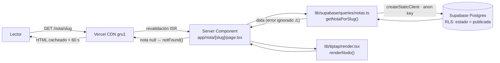
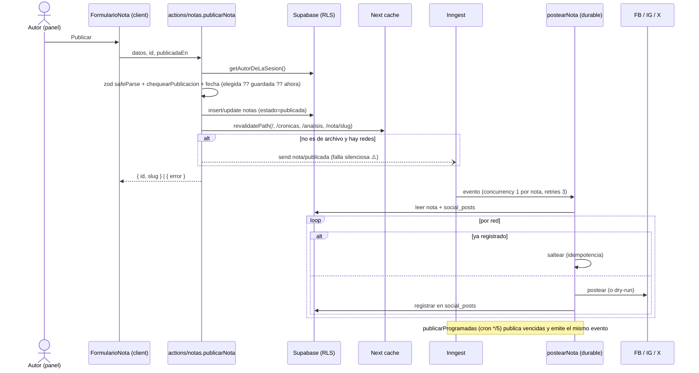
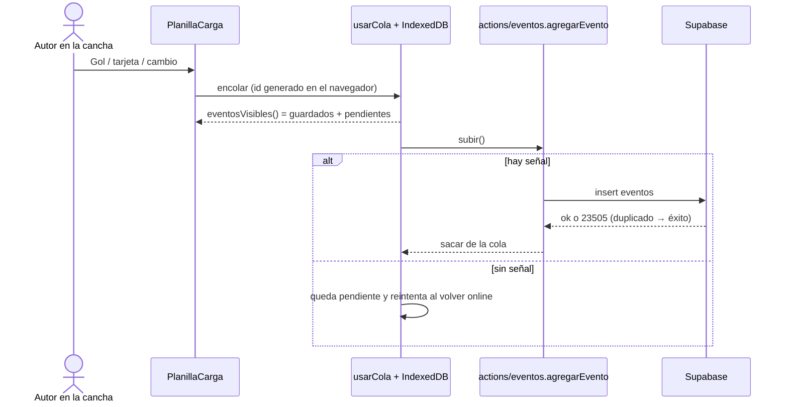

# Reporte de calidad — Periódico Delfos

> Generado el 26/10/2026 sobre `main` @ `a8b342a` (22/10/2026). Árbol limpio, sin `.env.local`.
> Todo lo que figura como **medido** se corrió en esta máquina; lo que figura como **reportado** sale de commits o de `HANDOFF.md` y no se pudo verificar desde acá.

> **Cambios posteriores a este análisis (26/10/2026):**
> - **CI:** ya existe ([.github/workflows/ci.yml](.github/workflows/ci.yml), PR #6): lint + tipos + tests + build. Lo que dice §1 sobre "no hay CI" describe el estado previo.
> - **Next 15.5.28** y parches de zod/vitest en `fix/back-dependencias-vulnerables`: 0 críticas (41 → 31 vulnerabilidades).
> - **Control de complejidad en el CI** (tope 25) en `chore/ci-complejidad`.
> - **Cobertura medida sobre todo `src/`:** 27 % de líneas. El detalle está en [REPORTE_COBERTURA.md](REPORTE_COBERTURA.md).

## Resumen ejecutivo

| Área | Estado | Por qué |
|---|---|---|
| CI | 🔴 | No hay CI. No existe `.github/workflows/` ni otro pipeline. Los chequeos previos al PR son manuales ([CONTRIBUTING.md](CONTRIBUTING.md)). ESLint estuvo roto desde el primer commit hasta el 11/10 y nadie se enteró. |
| Cobertura | 🟡 | La lógica pura (`src/lib/**`) tiene entre 81 y 93 % de líneas cubiertas. `src/actions/`, `src/lib/supabase/`, `src/lib/inngest/` y `middleware.ts` están en **0 %**. La UI (componentes y páginas) está en 0 %. **27 % de líneas sobre todo `src/`** (detalle en [REPORTE_COBERTURA.md](REPORTE_COBERTURA.md)). |
| Complejidad | 🟢 | Complejidad ciclomática promedio de 3,9. Hay 5 funciones por encima de 20. La duplicación es del 0,3 %. 4 componentes pasan el límite de 300 líneas que pone el propio proyecto. |
| Dependencias | 🔴 | `pnpm audit`: **41 vulnerabilidades (3 críticas, 21 altas)**. Las críticas son RCE en `next@15.5.23` y el parche está dentro del rango (`15.5.24`). |
| E2E | 🟡 | La suite de Playwright es amplia (255 tests: a11y, SEO, medidas, rendimiento, panel). No corre en CI y no cubre ni la publicación de notas ni la planilla. Corrida local: **233 ✅ · 12 ❌ · 10 skip**. 7 fallos son ruido del entorno, 4 son una probable regresión "sin JS" y 1 es flaky. |
| Estabilidad | 🔴 | Hay 4 problemas de producción **reportados el 15/10 y sin arreglar en `main`**: las 82 redirecciones WP terminan en 404, `/api/inngest` da 500, hay soft-404 y el ISR pisa páginas buenas cuando falla la base. El arreglo de pérdida/duplicación de notas está en una rama sin mergear desde hace 11 días. |

### Top 5 acciones (ordenadas por impacto/esfuerzo)

| # | Acción | Impacto | Esfuerzo |
|---|---|---|---|
| 1 | `pnpm update next@15.5.24 @tiptap/*@^3.30.5 zod@^4.6.6 vitest@^4.1.11` (todo dentro de los rangos actuales, sin romper el pin a Next 15) | Cierra las 3 críticas (RCE) y varias altas | 30 min |
| 2 | Agregar el workflow de CI de §1 (lint + tsc + vitest + build) y exigirlo en la protección de `main` | Evita que vuelva a pasar lo de "lint roto meses" y los merges directos a `main` | 1 h |
| 3 | Mergear `origin/fix/editor-sin-senal`, que arregla la pérdida de notas y los **posteos duplicados a redes**. Arreglar también las redirecciones con barra final y cargar `INNGEST_SIGNING_KEY` en Vercel | Recupera el SEO heredado de WordPress (regla no negociable #8) y el auto-posteo | 2–4 h |
| 4 | Que las queries de `src/lib/supabase/queries/*` **tiren error** cuando Supabase devuelve `error`, en vez de devolver vacío (~55 lugares) | Con la base caída, el ISR deja de guardar páginas vacías encima de las buenas | 2–3 h |
| 5 | Agregar `@vitest/coverage-v8` con umbral sobre `src/lib/**`, tests de `publicarNota`/`agregarEvento` con Supabase mockeado y un E2E de "publicar nota" | Cubre los flujos de negocio que hoy están en 0 % | 1–2 días |

Pendiente de seguridad fuera del código: la **contraseña de la base sigue sin rotar** y estuvo expuesta dos veces en un chat ([HANDOFF.md:2363-2370](HANDOFF.md#L2363-L2370)).

---

## 0. Contexto

| | |
|---|---|
| Lenguaje | TypeScript 5.9 (strict), SQL (Postgres) |
| Framework | Next.js 15.5.23 (App Router, Server Components, Server Actions), React 19.2 |
| UI | Tailwind v4, TipTap 3 (editor), Recharts, lucide-react |
| Datos | Supabase (Postgres + Auth + Storage + RLS). 18 migraciones y 13 tablas, todas con RLS |
| Jobs | Inngest 4: fan-out a FB/IG/X y un cron de notas programadas |
| Tests | Vitest 4 (unit), Playwright 1.62 + axe-core (E2E) |
| Paquetes | pnpm 11.1.2 (`packageManager`) |
| Deploy | Vercel, región `gru1` ([vercel.json](vercel.json)) |
| Runtime | Vitest 4 exige **Node ≥ 20**. La máquina tiene Node 18.17, así que se usó un Node 22 portable |

```
periodico-delfos/
├── src/
│   ├── app/            # rutas públicas, /admin/(panel)/*, /api/{inngest,og}, /auth/*, /demo/*
│   ├── actions/        # 15 Server Actions (notas, eventos, partidos, tabla, ...)
│   ├── components/     # admin/ (55), layout/, portada/, partido/, temporada/, content/ ...
│   ├── lib/            # lógica pura + tests, supabase/{queries,server,admin}, inngest/, social/, tiptap/, migracion/
│   ├── middleware.ts   # sólo /admin/*
│   └── types/
├── supabase/migrations # 0001–0020 (faltan 0015 y 0017)
├── e2e/                # 9 archivos Playwright
├── scripts/            # migrate-wp, generate-redirects, usuario-e2e
└── docs/, HANDOFF.md (3728 líneas), blueprint v1/v2
```

Historial: 175 commits entre el 03/09 y el 22/10/2026, 4 autores (Tomas ~154). 121 commits tienen `Co-Authored-By: Claude`. 36 ramas remotas, 5 sin mergear.

---

## 1. CI (Integración Continua)

**No hay CI.** Se buscó en `.github/workflows/`, `.gitlab-ci.yml`, `render.yaml`, `azure-pipelines.yml` y husky/pre-commit: no hay nada. [vercel.json](vercel.json) sólo define región y 82 redirects, sin `buildCommand` ni checks.

- Lo más cercano a un pipeline es **el build de Vercel**: la rama `origin/vercel/install-vercel-web-analytics-qzggsb` indica que el bot de Vercel tiene acceso al repo. No se puede ver si Vercel construye previews por PR porque no hay acceso a la cuenta.
- `gh` **no está instalado**, así que no se pudo correr `gh run list` ni leer issues/PRs.
- Los chequeos del PR son manuales: `tsc`, `vitest` y `next build` ([CONTRIBUTING.md](CONTRIBUTING.md), sección "Antes de abrir el PR").
- El proceso declarado ("`main` no se toca directo") no se cumple. Sólo 4 merges entraron por PR de GitHub (#1–#4) y desde el 11/10 hay 6 commits directos sobre `main`.
- Consecuencia concreta: **ESLint no validó nada desde el primer commit hasta el 11/10** (`4cdff50`). `next build` imprimía el error pero terminaba en verde ([HANDOFF.md:2007](HANDOFF.md#L2007)).

**Estado medido hoy** (Node 22, `pnpm install --frozen-lockfile`):

| Paso | Resultado | Tiempo |
|---|---|---|
| `pnpm install --frozen-lockfile` | ✅ | 36 s |
| `eslint .` | ✅ 0 errores, 5 warnings `no-img-element` (deliberados) | 8 s |
| `tsc --noEmit` | ✅ limpio | 11 s |
| `vitest run` | ✅ 756/756 tests, 44 archivos | 8 s |
| `next build` (sin env) | ✅ 45 páginas | 84 s |

### Workflow propuesto (sugerencia, no se creó el archivo)

`.github/workflows/ci.yml`:

```yaml
name: CI
on:
  pull_request:
  push:
    branches: [main]

concurrency:
  group: ci-${{ github.ref }}
  cancel-in-progress: true

jobs:
  verificar:
    runs-on: ubuntu-latest
    timeout-minutes: 15
    env:
      NEXT_TELEMETRY_DISABLED: 1
      # El build anda sin Supabase (verificado). Si se quieren datos reales, cargar como secrets:
      # NEXT_PUBLIC_SUPABASE_URL: ${{ secrets.NEXT_PUBLIC_SUPABASE_URL }}
      # NEXT_PUBLIC_SUPABASE_ANON_KEY: ${{ secrets.NEXT_PUBLIC_SUPABASE_ANON_KEY }}
    steps:
      - uses: actions/checkout@v4
      - uses: pnpm/action-setup@v4          # toma la versión de "packageManager"
      - uses: actions/setup-node@v4
        with:
          node-version: 22
          cache: pnpm
      - run: pnpm install --frozen-lockfile
      - run: pnpm lint
      - run: pnpm exec tsc --noEmit
      - run: pnpm test
      - uses: actions/cache@v4
        with:
          path: .next/cache
          key: next-${{ hashFiles('pnpm-lock.yaml') }}-${{ github.sha }}
          restore-keys: next-${{ hashFiles('pnpm-lock.yaml') }}-
      - run: pnpm build
      - run: pnpm audit --prod --audit-level=critical
```

Tiempo estimado: unos 3–4 min con caché, a partir de los tiempos medidos arriba. En un segundo paso se puede agregar un job de E2E con `npx playwright install --with-deps chromium` y quitar `channel: 'msedge'` en CI (ver [playwright.config.ts:733-738](playwright.config.ts#L733-L738)).

---

## 2. Cobertura de tests

- **Runner:** Vitest 4.1.10, `environment: 'node'`, `include: src/**/*.test.ts` ([vitest.config.mts](vitest.config.mts)). No hay tests de componentes: `happy-dom` está instalado pero ningún test lo usa.
- **No hay proveedor de cobertura instalado.** Se usó `@vitest/coverage-v8@4.1.10` desde una carpeta aparte, sin tocar `package.json`.
- **Corregido:** la primera versión de este reporte no pudo instrumentar los `.tsx` y estimó "~7 %" para todo `src/`, lo cual estaba mal. La causa era el `"jsx": "preserve"` de Next. Con el JSX transformado se midieron los 287 archivos. El detalle completo está en [REPORTE_COBERTURA.md](REPORTE_COBERTURA.md).

### Global (287 archivos de `src/`)

| Métrica | Todo `src/` | Sólo `.ts` (sin componentes ni páginas) |
|---|---|---|
| Líneas | **27,0 %** (1118/4143) | 51,7 % |
| Ramas | 25,6 % (941/3675) | 55,5 % |
| Funciones | 27,5 % (391/1420) | 60,6 % |
| Statements | 27,5 % (1302/4727) | 51,6 % |

### Por carpeta

| Carpeta | Archivos (medidos) | Líneas | Ramas | Funciones |
|---|---|---|---|---|
| `src/lib/entidades` (validación Zod) | 10 (10) | 93,3 % | 86,9 % | 95,2 % |
| `src/lib/tiptap` | 5 (5) | 56,5 % | 56,0 % | 47,1 % (`render.tsx` y `extensiones.tsx` en 0 %) |
| `src/lib/social` | 5 (5) | 88,9 % | 84,5 % | 89,1 % |
| `src/lib/migracion` | 12 (12) | 84,3 % | 79,0 % | 75,0 % |
| `src/lib` (raíz: partido, temporada, nota, seo...) | 24 (24) | 80,9 % | 84,2 % | 81,8 % |
| `src/lib/supabase` (queries + clientes) | 14 (14) | **0 %** | 0 % | 0 % |
| `src/lib/inngest` | 3 (3) | **0 %** | 0 % | 0 % |
| `src/actions` | 15 (15) | **0 %** | 0 % | 0 % |
| `src/middleware.ts` | 1 | **0 %** | 0 % | 0 % |
| `src/app` | 81 (81) | 0 % (0/664) | 0 % | 0 % |
| `src/components` | 116 (116) | 0 % (0/1358) | 0 % | 0 % |

### Los 10 archivos críticos con menor cobertura

| # | Archivo | Cobertura | Por qué es crítico |
|---|---|---|---|
| 1 | [src/actions/notas.ts](src/actions/notas.ts) | 0 % (0/70) | Publicar, programar, fechar y disparar el posteo. Tiene 2 bugs históricos (fecha, firma) |
| 2 | [src/lib/inngest/funciones/nota-publicada.ts](src/lib/inngest/funciones/nota-publicada.ts) | 0 % (0/45) | Fan-out a redes con idempotencia; un error acá publica dos veces |
| 3 | [src/lib/inngest/funciones/publicar-programadas.ts](src/lib/inngest/funciones/publicar-programadas.ts) | 0 % (0/29) | Cron cada 5 min que publica solo |
| 4 | [src/actions/eventos.ts](src/actions/eventos.ts) | 0 % (0/32) | Carga de goles/tarjetas en vivo (trata el `23505` como éxito) |
| 5 | [src/lib/supabase/queries/notas.ts](src/lib/supabase/queries/notas.ts) | 0 % (0/65) | Todas las lecturas de notas; ignora `error` (§3) |
| 6 | [src/middleware.ts](src/middleware.ts) | 0 % (0/16) | Redirección a login de `/admin` |
| 7 | [src/actions/autor.ts](src/actions/autor.ts) | 0 % (0/54) | Alta de colaboradores (auth + service role) |
| 8 | [src/lib/social/registro.ts](src/lib/social/registro.ts) | 0 % (0/14) | Escribe `social_posts`, que es la base de la idempotencia |
| 9 | [src/components/admin/usarCola.ts](src/components/admin/usarCola.ts) | 0 % (0/50) | Cola offline de la planilla. La lógica pura (`lib/cola.ts`) sí está al 100 % |
| 10 | [src/app/auth/confirm/route.ts](src/app/auth/confirm/route.ts) | 0 % (0/10) | Login por magic link; tuvo un bug (`631f1e2`) |

Patrón: el proyecto saca la lógica a funciones puras con buenos tests (`nota.ts`, `cola.ts`, `fanout.ts` al 92–100 %), pero **el pegamento con Supabase, Inngest y Auth no tiene ningún test**.

### Tests que fallan o están skipeados

- **Unit:** 0 fallan, 0 skipeados.
- **E2E (por diseño):**
  - `admin.setup.ts` y `admin.spec.ts` se saltean si faltan `E2E_ADMIN_EMAIL` y `E2E_ADMIN_PASSWORD`.
  - [e2e/admin.spec.ts:73,88](e2e/admin.spec.ts#L73), [e2e/rendimiento.spec.ts:169](e2e/rendimiento.spec.ts#L169) y [e2e/seo.spec.ts:140](e2e/seo.spec.ts#L140) se saltean si la base no tiene datos.
  - [e2e/medidas.spec.ts:164](e2e/medidas.spec.ts#L164): `test.fixme()` para errores de consola en `/demo/nota` y `/demo/articulo`. El comentario dice que "se arregla en `fix/accesibilidad-y-pie`", pero esa rama **ya se mergeó el 18/09** (`423c284`). El fixme probablemente quedó viejo: hay que revisarlo y sacarlo.

---

## 3. Historial de problemas (incidentes)

Fuentes: `git log --all` (asuntos y cuerpos con fix/bug/revert/roto), `HANDOFF.md` y la rama sin mergear `origin/fix/editor-sin-senal`. **No hay TODO/FIXME/HACK** en `src/`, `scripts/`, `e2e/` ni `supabase/`. No se pudieron consultar issues/PRs porque `gh` no está instalado.

### Build / deploy / tooling

| # | Problema | Causa raíz | Qué afectaba | Resolución | Fecha | ¿Test hoy? |
|---|---|---|---|---|---|---|
| 1 | El primer deploy a Vercel se caía con `ERR_INVALID_URL` | `NEXT_PUBLIC_SITE_URL=''`: el `??` no atrapa el string vacío | Deploy entero | `288fa69`, `urlDelSitio()` | 21/09 | ✅ [sitio.test.ts](src/lib/sitio.test.ts) |
| 2 | Canonicals/sitemap/OG apuntaban a la URL efímera del deploy | El fallback usaba `VERCEL_URL` | SEO, previews de WhatsApp | `349f51f` | 21/09 | ✅ sitio.test.ts |
| 3 | `vercel.json` no existía: ninguna redirección de WP activa | El script estaba escrito pero nunca se corrió | 82 URLs viejas | `b4a78e9` | 15/09 | ✅ parcial (`migracion/vercel.test.ts`) |
| 4 | **ESLint no corría desde el primer commit** | Config flat importando `eslint-config-next` (formato eslintrc); `next build` no fallaba | Calidad de todo el código | `4cdff50`, `FlatCompat` | 11/10 | ❌ sin CI que lo detecte |
| 5 | La medición de LCP medía el arranque del navegador | Corridas en paralelo y sin calentamiento | Suite de rendimiento | `fada586` | 21/09 | n/a (es el test) |
| 6 | 🔁 **Las 82 redirecciones WP terminan en 404** (reportado, abierto) | `source` con barra final; Next responde 308 sin barra antes de matchear | SEO heredado; regla #8 | Sin arreglar. Documentado en `dc28ce9` (rama sin mergear) | 15/10 | ❌ |
| 7 | **`GET /api/inngest` da 500 en prod** (reportado, abierto) | Probablemente falta `INNGEST_SIGNING_KEY` en Vercel | Auto-posteo y notas programadas | Sin arreglar | 15/10 | ❌ |

### DB / datos

| # | Problema | Causa raíz | Qué afectaba | Resolución | Fecha | ¿Test hoy? |
|---|---|---|---|---|---|---|
| 8 | **El ISR guarda páginas vacías si falla Supabase** (reportado, abierto) | Las queries descartan `error` (~55 `const { data } = await`; verificado en `src/lib/supabase/queries/*`) | Todo el sitio público: notas como "no encontrada" + `noindex` | Sin arreglar | 15/10 | ❌ |
| 9 | Soft 404: las páginas inexistentes devuelven 200 (reportado) | No verificado | SEO | Sin arreglar | 15/10 | ❌ |
| 10 | El seed no estaba corrido y las tablas estaban vacías | Paso manual sin hacer | Todo lo que depende de datos | Lo corrió el usuario a mano | 20/09 | n/a |

### Auth / seguridad

| # | Problema | Causa raíz | Qué afectaba | Resolución | Fecha | ¿Test hoy? |
|---|---|---|---|---|---|---|
| 11 | El magic link fallaba con `otp_expired` | El template de Supabase devuelve los tokens en el fragmento de la URL, que no llega al servidor | Login al panel | `631f1e2`, `/auth/confirm` con `verifyOtp` | 20/09 | ❌ |
| 12 | `service_role` original expuesta y en uso | No se había rotado (`iat` = `created_at`) | Bypass total de RLS | Reemplazada + legacy JWT deshabilitadas (HANDOFF) | 20/09 | n/a |
| 13 | Contraseña de la base expuesta en un chat | Credenciales pegadas en una conversación | DB | **Abierto**, falta rotarla | 20/09 | n/a |

### Lógica de negocio (notas)

| # | Problema | Causa raíz | Qué afectaba | Resolución | Fecha | ¿Test hoy? |
|---|---|---|---|---|---|---|
| 14 | Editar una nota le cambiaba la firma | `autor_id` viajaba también en el update | Atribución de notas publicadas | `30439ef` + `autores.firma_como` (0011) | 21/09 | ✅ parcial (`nota.test.ts`; el action no) |
| 15 | 🔁 Editar una nota la refechaba al día de hoy | `publicada_en: new Date()` siempre | Orden de portada, archivo | `b1eb205` | 11/10 | ✅ parcial (`nota.test.ts`) |
| 16 | 🔁 La fecha elegida en el formulario se ignoraba | El campo sólo existía en la vista previa | Notas de archivo | `b1eb205` | 11/10 | ✅ parcial |
| 17 | 🔁 El panel mostraba `updated_at` en vez de la fecha de publicación | El listado usaba la columna equivocada | UX del panel | `a8b342a` | 22/10 | ❌ |
| 18 | **Un corte de red al guardar perdía la nota o la duplicaba (con 2 posteos a redes)** | Sin id del lado cliente, sin `error.tsx`; el `Failed to fetch` no se atajaba | Datos + redes (irreversible) | `b78d8e6` en `origin/fix/editor-sin-senal`, **sin mergear** | 15/10 | ⚠️ en la rama (25 unit + e2e); en `main` no |
| 19 | Un gol cargado sin señal se perdía | Escritura directa al servidor | Planilla en vivo | `779a971`, cola en IndexedDB | 20/09 | ✅ `cola.test.ts` (el hook no) |

### UI / accesibilidad / SEO

| # | Problema | Resolución | Fecha | ¿Test hoy? |
|---|---|---|---|---|
| 20 | Faltaban `og:site_name`, `og:locale` y `og:image` (un `openGraph` por página pisa el del layout) | `24c1262` | 21/09 | ✅ `seo.test.ts` + `e2e/seo.spec.ts` |
| 21 | Scroll horizontal no operable con teclado (línea de tiempo, tabla) | `dfa21bb` | 21/09 | ✅ `e2e/accesibilidad.spec.ts` |
| 22 | 4 páginas sin `h1` | `271505d` | 21/09 | ✅ `e2e/medidas.spec.ts` |
| 23 | 🔁 Scroll horizontal por `.sr-only` sin ancestro `relative` (3 apariciones) | `b5c58af` + regla #5 de CLAUDE.md | 17/09 | ✅ `medidas.spec.ts` |
| 24 | 🔁 Layout de portada: tapa demasiado alta, grilla corrida sin análisis, tabla demasiado ancha | `299a1ac`, `39eb4b5`, `7c223f1` | 28/09–06/10 | ❌ |
| 25 | Cabecera sticky entera / buscador transparente sobre la fecha | `4831fc1`, `274913c` | 01/10 | ❌ |
| 26 | `color-scheme` faltante en tema oscuro | `b4a78e9` | 15/09 | ❌ |

### Dependencias

| # | Problema | Estado |
|---|---|---|
| 27 | `@eslint/eslintrc` declarado pero sin usar; un hook bloqueaba editar `eslint.config.mjs` | Resuelto con `4cdff50` |
| 28 | 41 vulnerabilidades (`pnpm audit`, ver §5) | **Abierto** |

### Problemas recurrentes

- **Fechas de las notas** (#15, #16, #17): 3 bugs en 11 días sobre el mismo dato. La lógica pura está testeada; la capa action/UI no.
- **Configuración de entorno y deploy** (#1, #2, #7): variables vacías o faltantes rompen en silencio. Conviene validar el env con Zod al arrancar.
- **Fallos silenciosos** (#4, #8, #7, y el `catch {}` de [src/actions/notas.ts:166](src/actions/notas.ts#L166)): errores que se tragan sin alertar.
- **Layout y scroll horizontal** (#23, #24): mitigado por `medidas.spec.ts`, que hoy sólo corre a mano.
- **Lo arreglado queda fuera de `main`:** `fix/editor-sin-senal` (11 días) y `feat/admin-casillero-analytics` (20 días) sin mergear, contra la regla de "las ramas viven días" de CONTRIBUTING.

---

## 4. Flujo del código

### Puntos de entrada

| Tipo | Rutas |
|---|---|
| Públicas (SSG/ISR `revalidate = 60`) | `/`, `/cronicas`, `/analisis`, `/fixture`, `/plantel`, `/plantel/[temporadaSlug]`, `/nota/[slug]`, `/partido/[slug]`, `/jugadora/[slug]`, `/quienes-somos`, `/contacto`, `/privacidad` |
| Dinámicas | `/temporada/[slug]`, `/buscar` (`<form method="get">`), `@modal/(.)partido/[slug]` (ventana interceptada) |
| Panel | `/admin/login`, `/admin/(panel)/*`: notas, partidos (+planilla, formación), temporadas, tabla, plantel, jugadoras, equipos, sponsors, páginas, posteos, estadísticas, autores, perfil |
| API | `/api/inngest` (GET/POST/PUT, firma `INNGEST_SIGNING_KEY`), `/api/og` (imagen OG, edge), `/auth/callback` (PKCE), `/auth/confirm` (magic link), `/rss.xml`, `/sitemap.xml`, `/robots.txt` |
| Mutaciones | 15 Server Actions en [src/actions/](src/actions/) |
| Jobs | `postearNota` (evento `nota/publicada`, `retries: 3`, `concurrency` 1 por nota), `publicarProgramadas` (cron `*/5 * * * *`) |

### Capas de protección

1. [src/middleware.ts](src/middleware.ts): sólo `/admin/:path*`. Usa `getUser()` (valida contra Auth) y, si no hay usuario, redirige a `/admin/login?volver=`.
2. Layout del panel: vuelve a chequear y exige fila en `autores`.
3. Cada action: `getAutorDeLaSesion()`, después `safeParse` con Zod.
4. **RLS en las 13 tablas** (`0008_rls.sql`, `es_autor()`): es la defensa real.
5. Service role sólo en [src/lib/supabase/admin.ts](src/lib/supabase/admin.ts). La usan `autor.ts`, `imagenes.ts`, Inngest y `registro.ts`.

### Manejo de errores

- Las actions devuelven `{ error, motivos }` en vez de tirar, y el `23505` se traduce a "slug repetido" ([src/actions/notas.ts:131-135](src/actions/notas.ts#L131-L135)).
- **No hay `error.tsx`, `global-error.tsx` ni `not-found.tsx` en `main`.** Un error inesperado muestra la pantalla genérica de Next en inglés, contra la regla #9 ("todo string en español").
- Las queries públicas ignoran `error` (§3 #8).
- Inngest: hasta 3 reintentos; la idempotencia sale de `social_posts (nota_id, platform)`.

### Flujo 1 — Lectura pública (ISR)



### Flujo 2 — Publicar una nota y auto-postear



### Flujo 3 — Planilla en vivo (offline-first)



---

## 5. Complejidad del código

Medido con `eslint src scripts --rule complexity` (sin tocar la config): **852 funciones**, promedio **3,86**; 33 funciones > 10, 7 > 15, 5 > 20. Profundidad de anidamiento máxima: 4 ([src/components/admin/usarCola.ts:89](src/components/admin/usarCola.ts#L89)).

### Top 10 funciones más complejas

| # | Complejidad | Función | Sugerencia de refactor |
|---|---|---|---|
| 1 | 25 | `renderNodo`, [src/lib/tiptap/render.tsx:121](src/lib/tiptap/render.tsx#L121) | Pasar el `switch` por tipo de nodo a un registro `{ [tipo]: (nodo) => JSX }`. Agregar tests: hoy no se mide (`.tsx`) |
| 2 | 24 | `sanearNodo`, [src/lib/migracion/cuerpo.ts:114](src/lib/migracion/cuerpo.ts#L114) | Un handler por tipo de nodo. Prioridad baja: es código de migración, de un solo uso, y está al 97 % |
| 3 | 22 | `PlanillaCarga`, [src/components/admin/PlanillaCarga.tsx:74](src/components/admin/PlanillaCarga.tsx#L74) | Sacar un hook `usarPlanilla` (marcador, en cancha, cola) y subcomponentes por lado |
| 4 | 22 | `transformarPost`, [src/lib/migracion/transformar.ts:165](src/lib/migracion/transformar.ts#L165) | Componerlo como pipeline de pasos puros (título → bajada → cuerpo → imágenes) |
| 5 | 21 | `Estadisticas`, [src/app/admin/(panel)/estadisticas/page.tsx:57](src/app/admin/(panel)/estadisticas/page.tsx#L57) | Mover el armado por pestaña a `lib/estadisticas.ts` (ya testeado) y dejar la page sólo para renderizar |
| 6 | 19 | `entradaDesde`, [src/components/admin/FormularioSponsor.tsx:43](src/components/admin/FormularioSponsor.tsx#L43) | Reemplazar el mapeo manual por un `z.object(...).transform()` en `lib/entidades/sponsor.ts`, que hoy tiene 0 % |
| 7 | 16 | `publicarNota`, [src/actions/notas.ts:204](src/actions/notas.ts#L204) | Extraer `resolverFechaDePublicacion()` pura y un `escribirNota()` compartido con `guardarNota` (jscpd detecta 3 clones internos) |
| 8 | 15 | `darDeAltaAutor`, [src/actions/autor.ts:88](src/actions/autor.ts#L88) | Separar la invitación de Auth y el alta de la fila; usar retornos tempranos |
| 9 | 14 | `PaginaJugadora` [src/app/jugadora/[slug]/page.tsx:92](src/app/jugadora/[slug]/page.tsx#L92) / `EditorCuerpo` [src/components/admin/EditorCuerpo.tsx:69](src/components/admin/EditorCuerpo.tsx#L69) | Bajar los derivados a `lib/jugadora.ts`; partir la barra de herramientas de `EditorCuerpo` |
| 10 | 14 + 14 | `deInstagram` / `deX`, [src/lib/tiptap/posteo.ts:150](src/lib/tiptap/posteo.ts#L150) y [:173](src/lib/tiptap/posteo.ts#L173) | Un solo parser de URL parametrizado por red (host, patrón de id) |

### Archivos más largos

| Archivo | Líneas | Nota |
|---|---|---|
| `scripts/migrate-wp.ts` | 523 | Script I/O secuencial; lo deja así a propósito ([HANDOFF.md:751](HANDOFF.md#L751)) |
| `src/lib/partido.ts` | 465 | Creció desde las 363 de la nota del HANDOFF; partir en `partido/lados.ts` + `partido/eventos.ts` |
| `src/lib/nota.ts` | 431 | |
| `src/lib/supabase/queries/notas.ts` | 390 | 0 % de cobertura |
| `src/actions/notas.ts` | 366 | 0 % de cobertura |
| **Componentes que pasan el límite de 300 líneas (regla #1 de CLAUDE.md)** | | `EditorCuerpo.tsx` 356, `EditorTabla.tsx` 335, `FormularioNota.tsx` 323, `PlanillaCarga.tsx` 301 |

### Duplicación (jscpd, mínimo 8 líneas)

0,3 % (110 líneas, 7 clones):
- [src/app/analisis/page.tsx](src/app/analisis/page.tsx) y [src/app/cronicas/page.tsx](src/app/cronicas/page.tsx): 45 líneas casi idénticas. Conviene una factoría `paginaListado(tipo)`.
- `CampoFoto.tsx:45` y `CampoImagen.tsx:58` (18 líneas).
- `contacto/page.tsx:40` y `quienes-somos/page.tsx:40` (17 líneas).
- `actions/notas.ts`: 3 clones internos (117↔348, 117↔248, 207↔324), es el insert/update repetido.

### Dependencias vulnerables (`pnpm audit`)

**41: 3 critical · 21 high · 15 moderate · 2 low.**

| Severidad | Paquete | Origen | Parche | ¿Rompe? |
|---|---|---|---|---|
| 🔴 critical | `next@15.5.23` (RCE en Image Optimization con AVIF; RCE en servidores Windows) | directo | `15.5.24` | No, está dentro de `^15.5.0` |
| 🟠 high | `@tiptap/core@3.29.2` (ReDoS, `__proto__` en `mergeAttributes`) | directo (**pin exacto**) | `≥3.30.5` | Hay que soltar el pin de `@tiptap/core` |
| 🟠 high | `prosemirror-view@1.42.2` (XSS al pegar) | vía tiptap | `≥1.42.3` | |
| 🟠 high | `zod@4.4.3` (agotamiento de memoria) | directo | `≥4.6.6` | No |
| 🟠 high | `sharp@0.34.5`, `postcss@8.4.31`, `nanoid@3.3.17`, `source-map-js` | vía next | se arreglan al subir next | |
| 🟠 high | `@grpc/grpc-js@1.14.4` | vía inngest (OpenTelemetry) | `inngest@4.26` | No |
| 🟠 high | `happy-dom@20.11.2` (ejecución de código) | dev, **sin uso** | `21.0.4` | Mejor sacarlo |
| 🟠 high | `vite@8.2.1`, `brace-expansion`, `js-yaml` | dev (vitest/eslint) | `vitest@4.1.11` | No |

### Desactualizadas (`pnpm outdated`)

- **Majors que no conviene tocar ahora:** `next` 16 (pin deliberado a 15), `eslint` 10, `eslint-config-next` 16, `typescript` 7, `vitest` 5, `@hookform/resolvers` 6, `@types/node` 26.
- **Menores seguras:** `inngest` 4.16 → 4.26, `lucide-react` 1.29 → 1.61, `@supabase/supabase-js` 2.112 → 2.118, `react` 19.2.8 → 19.3.1 (**pin exacto**), `@playwright/test` 1.62 → 1.64, `@tiptap/*` 3.29 → 3.32.

---

## 6. Tests E2E

**Sí existen:** Playwright 1.62 + `@axe-core/playwright`, 9 archivos y 1129 líneas en [e2e/](e2e/). Corren contra `next start -p 3100` en Edge (`channel: 'msedge'`), en 4 combinaciones de 375/1280 px × tema claro/oscuro.

### Qué cubren

| Spec | Flujo / propiedad | Proyectos |
|---|---|---|
| `accesibilidad.spec.ts` | WCAG 2.1 AA (axe) sobre 12+ rutas | 4 viewports/temas |
| `medidas.spec.ts` | Responde 200, sin scroll horizontal, sin errores de consola, un solo `h1` | 4 |
| `seo.spec.ts` | Metadata, canonical, OG image, `noindex` en demos/panel, robots, sitemap, RSS | 1 |
| `rendimiento.spec.ts` | LCP < umbral en 4G simulado (`/`, `/cronicas`, último partido) | 1 (serial) |
| `ventana.spec.ts` | Modal `<dialog>` de la planilla: foco, Escape, restauración | 4 |
| `tabla-por-fecha.spec.ts` | Navegación de la tabla por fecha (demo) | 4 |
| `admin.setup.ts` + `admin.spec.ts` | Login, secciones del panel, validaciones de formularios, editor, tabla precargada | 1 (necesita credenciales) |

### Qué falta

1. **Publicar una nota de punta a punta**: crear → vista previa → publicar → aparece en `/` y en `/nota/[slug]`. Es el flujo central del negocio y no tiene ningún E2E.
2. **Planilla en vivo**: cargar un gol, cortar la red (`context.setOffline`), reconectar y verificar que se sube una sola vez.
3. **Redirecciones WP**: un muestreo de `vercel.json` (con y sin barra final) que verifique 301 → 200. Hubiera detectado §3 #6.
4. **Búsqueda** (`/buscar?q=`) sin JS.
5. **Programar una nota** y verificar que el cron la publica (con `inngest-cli dev`).
6. El spec `e2e/admin.borrador.spec.ts` existe, pero sólo en la rama sin mergear.

### ¿Corren en CI?

No: no hay CI. Sólo se corren a mano.

### Estado actual (corrida local de esta sesión)

Se corrió `playwright test` contra `next start` (build sin Supabase y sin credenciales del panel), con Edge local. Tardó 2,9 min.

| Resultado | Cantidad |
|---|---|
| ✅ pasan | **233** |
| ⏭️ skipeados | 10 (sin datos en la base: SEO de contenido, LCP del partido, `fixme` de consola) |
| ❌ fallan | **12** |
| Panel (`admin.*`) | No se armó: faltan `E2E_ADMIN_EMAIL`/`PASSWORD` |

Análisis de los 12 fallos:

| Fallos | Test | Causa | ¿Bug real? |
|---|---|---|---|
| 7 | `medidas.spec.ts:92`, "no tira errores", en rutas sueltas (`/demo/*`, `/plantel`, `/fixture`) y **sólo en algunos proyectos** | `404 /_vercel/insights/script.js`: `@vercel/analytics` sólo existe desplegado en Vercel. Es intermitente porque depende de si el 404 llega antes del `load` | **No.** Hay que agregar ese patrón a `esRuido()` en [e2e/medidas.spec.ts](e2e/medidas.spec.ts) o no montar `<Analytics/>` fuera de Vercel |
| 4 | `ventana.spec.ts:110`, "sin JavaScript › el chip navega a la página entera", **en los 4 proyectos** | Timeout de 30 s después del click con `javaScriptEnabled: false` | **Probable regresión, a investigar.** Es determinístico. El test existe justamente para avisar si el chip deja de ser un link navegable sin JS |
| 1 | `ventana.spec.ts:71`, Escape cierra la ventana (sólo `celular-oscuro`) | `dialog[open]` no apareció en 5 s | Flaky: pasa en los otros 3 proyectos |

Para que la suite sea útil en CI hay que resolver primero el ruido de Analytics. Si no, el rojo intermitente enseña a ignorar los fallos, que es lo mismo que advierte el comentario de [e2e/medidas.spec.ts:152-163](e2e/medidas.spec.ts#L152-L163).

### Ejemplo de E2E prioritario faltante (no se creó el archivo)

Es el flujo de publicación. Va en el proyecto `panel` (usa la sesión de `admin.setup.ts`). Deja `SOCIAL_DRY_RUN=true` para no postear a las redes.

```ts
// e2e/admin.publicar.spec.ts
import { expect, test } from '@playwright/test'
import { HAY_CREDENCIALES, SIN_CREDENCIALES } from './credenciales'

test.skip(!HAY_CREDENCIALES, SIN_CREDENCIALES)

test('publicar una nota la muestra en la portada y en su página', async ({ page }) => {
  const titulo = `E2E ${Date.now()}`
  await page.goto('/admin/notas/nueva')
  await page.getByLabel('Título').fill(titulo)
  await page.getByLabel('Bajada').fill('Bajada de prueba generada por la suite.')
  await page.locator('.ProseMirror').fill('Cuerpo de prueba.')
  await page.getByRole('button', { name: /publicar/i }).click()
  await expect(page.getByText(/publicada/i)).toBeVisible()

  await page.goto('/')
  await expect(page.getByRole('link', { name: titulo })).toBeVisible()
  await page.getByRole('link', { name: titulo }).click()
  await expect(page.getByRole('heading', { level: 1, name: titulo })).toBeVisible()
  // Limpieza: despublicar desde el panel (o borrar con service role en un afterAll).
})
```

> Los labels (`Título`, `Bajada`) hay que confirmarlos contra [src/components/admin/FormularioNota.tsx](src/components/admin/FormularioNota.tsx) antes de usarlo. No se pudo correr porque no hay credenciales ni base.

---

## Anexo — cómo se midió

- Node 22.23.4 portable (la máquina tiene 18.17, que Vitest 4 no soporta) y pnpm 11.1.2 vía corepack. `pnpm install --frozen-lockfile` no modificó el lockfile.
- Cobertura: `@vitest/coverage-v8` instalado fuera del repo, `--coverage.include=src/**/*.{ts,tsx}`, con `oxc.jsx` en un config aparte para poder instrumentar los `.tsx` (ver [REPORTE_COBERTURA.md](REPORTE_COBERTURA.md)).
- Complejidad: `eslint src scripts --rule '{"complexity":["warn",1]}'`. Duplicación: `jscpd@4 --min-lines 8 --min-tokens 70`, excluyendo tests, demos y `types.ts`.
- `pnpm audit` y `pnpm outdated` del 26/10/2026.
- No se pudo usar `gh` (no instalado) ni acceder a Vercel o Supabase. Los problemas de producción de §3 (#6–#9) son **reportados** por el commit `dc28ce9` (rama `origin/fix/editor-sin-senal`); de esos, sólo #8 se verificó leyendo el código.
- No se modificó código del proyecto. Lo único nuevo en el árbol es este archivo (más `node_modules/` y `.next/`, que están en `.gitignore`).
